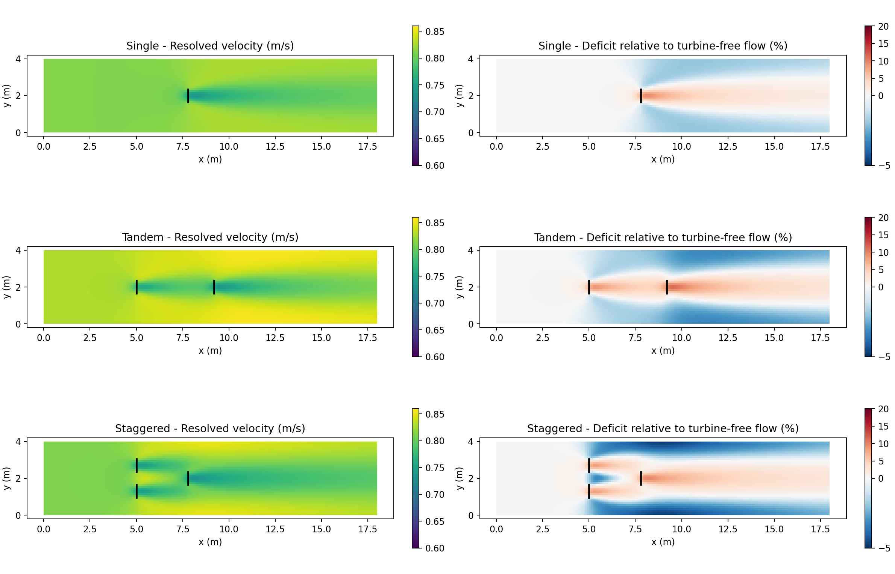

  

# BRAIDS-HKT

### River hydrodynamics and hydrokinetic energy assessment

BRAIDS-HKT is a Windows desktop application for exploring how river flow can supply hydrokinetic energy. Build a river model from a digital elevation model, place turbines, simulate their interaction with the flow, and follow the power produced by each device as conditions change.

The project aims to support estimates of **hydrokinetic energy potential in rivers**, from individual turbine locations to river reaches with multiple devices. It brings terrain, flow, turbine placement and power results together in one graphical workspace.

**[Download the Windows installer](https://github.com/cgotelli/BRAIDS-HKT/releases/latest)** · **[Releases](https://github.com/cgotelli/BRAIDS-HKT/releases)**

## Flow and power in the same simulation

A turbine changes the water that supplies it. BRAIDS-HKT represents that interaction in the hydraulic solution, so a downstream device experiences the wake of an upstream turbine. This makes it possible to explore single devices, tandem arrangements and staggered layouts while viewing both the flow field and turbine performance.

*Example outputs: resolved depth-averaged velocity on the left and velocity deficit relative to turbine-free flow on the right. Black segments indicate turbine positions.*

## From terrain to an energy assessment

- **Create the river domain:** import terrain, draw the domain, define internal obstacles and assign hydraulic roughness.
- **Build the mesh:** choose the river resolution, use breaklines and refine locally around turbines and their wakes.
- **Define the flow:** configure inlet and outlet conditions, initial water levels and time-varying discharge.
- **Place turbines:** specify rotor dimensions, placement, orientation, clearances and device performance data.
- **Run on CPU or GPU:** choose the calculation backend explicitly in the interface.
- **Explore the results:** view animated flow maps, particles, profiles and boundary-flow histories.
- **Follow production:** inspect per-turbine velocity, thrust, power, operating status and energy, and export time histories to CSV.
- **Continue a project:** keep settings, terrain, results and checkpoints together in a project folder.

The intended workflow is to compare candidate locations and arrangements under representative river discharges, then use the resulting power histories to assess production across the flow conditions of interest.

## Origins

BRAIDS-HKT is derived from **[GeoClaw](https://www.clawpack.org/geoclaw.html)**, part of the [Clawpack](https://www.clawpack.org/) ecosystem. It builds on GeoClaw's augmented f-wave approach to the shallow-water equations and wetting and drying, with BRAIDS developments for river meshes, CPU/GPU execution and turbine–flow coupling.

The standalone graphical interface adapts mapping and desktop components from [AVAC Desktop](https://github.com/cgotelli/AVAC-Desktop/).

## Install

1. Open the **[latest release](https://github.com/cgotelli/BRAIDS-HKT/releases/latest)**.
2. Download **`BRAIDS-HKT-0.1.0-Windows-x64-Setup.exe`** and run it.
3. Launch **BRAIDS-HKT** from the Start menu or desktop shortcut.

The installer supplies the application, Python environment and solver libraries. No Python installation or compiler is needed. GPU execution requires a compatible NVIDIA GPU and driver; CPU execution is also available.

**Install the application from Releases.** GitHub's automatic source-code ZIP and TAR downloads are source snapshots, not application installers.

## License and credits

BRAIDS-HKT is distributed under the **GNU Affero General Public License, version 3 or later**. Upstream components retain their own licenses and copyright notices. See [LICENSE](LICENSE) and [THIRD_PARTY_NOTICES.md](THIRD_PARTY_NOTICES.md).
